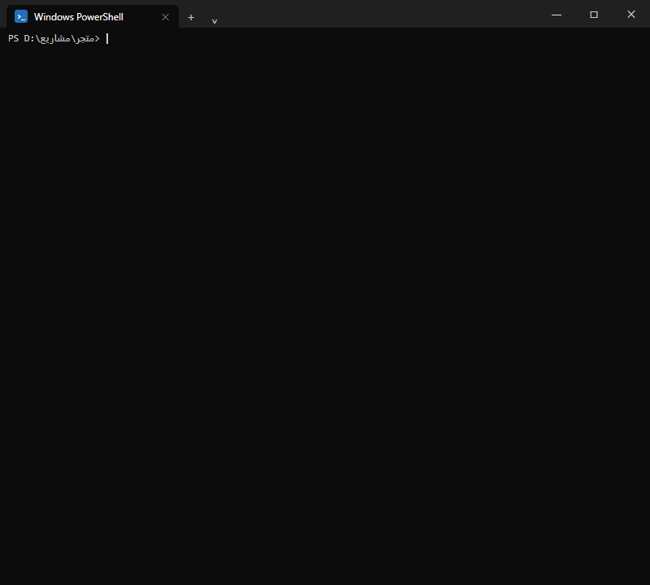

# pathdoc

**Your Windows build breaks because a folder name isn't English. pathdoc finds where, tells you which tool breaks and why, and cures it: a user setting it changes for you, or an ASCII path to build from. Every change can be undone.**

<p align="center">
  
</p>

<p align="center">English · <a href="docs/README.zh-CN.md">中文</a> · <a href="docs/README.ar.md">العربية</a> · <a href="docs/README.ru.md">Русский</a> · <a href="docs/README.ja.md">日本語</a></p>

Java, Gradle, Dart and Python still break on paths like `C:\Users\محمد`, `C:\Users\张伟`, `C:\Users\Иван` or `D:\Projects\Café`. The error never says "path". It says `Could not find or load main class`, `Unable to write file`, `FormatException`, `UnicodeEncodeError` — and a GitHub search for "non-ASCII characters in path" returns more than 11,000 issues.

pathdoc is one `.exe` with nothing to install. It reads your code page, your environment and the versions of your tools (from their files, never by running them), and in a fraction of a second reports only what will break on **your** machine: the path, the tools it breaks, the exact error you will see, and the proof.

## Install

```powershell
irm https://raw.githubusercontent.com/Fd3os/pathdoc/main/install.ps1 | iex
```

The installer picks the build for your CPU (x64 or ARM64), checks its SHA-256 against the release's `SHA256SUMS.txt`, puts `pathdoc.exe` in `%LOCALAPPDATA%\Programs\pathdoc` and adds that folder to your user `Path`. No admin. Or take the `.exe` from [Releases](https://github.com/Fd3os/pathdoc/releases) and run it from a terminal.

Windows 10 or 11.

## Use

```text
pathdoc          scan this machine and the project in this folder
pathdoc fix      set the user environment variables that cure what scan found (shows the plan, asks first)
pathdoc here     make an ASCII junction to this project and print where to build from
pathdoc undo     put back everything fix and here changed
```

`--json` prints the scan for scripts. `--root DIR` changes where `fix` and `here` put things (default `C:\dev`). `fix --yes` applies without asking, `here --name NAME` names the junction, `undo --force` also restores values you changed after `fix`. Exit codes: `0` clean, `1` problems found, `2` pathdoc itself failed.

## What it finds

Each rule was reproduced on Windows 10 (code page 1252) in three folders, `plain`, `café` and `ابوي`, and is reproduced again every week on a GitHub Actions Windows runner, failing before its cure and passing after it ([`repro/`](repro), [workflow](.github/workflows/repro.yml)).

Two kinds of trigger. **Not in your code page:** a character your Windows ANSI code page cannot write. Arabic breaks on a Western European system and `café` does not; Chinese on a Chinese-locale system (code page 936) should not either, though that case is not reproduced (the lab and CI run code page 1252). **Any non-ASCII:** even `café` breaks.

| Rule | Breaks when | You see | Cure | Proof |
|---|---|---|---|---|
| `gradle-project-path` | the project folder is not in your code page (Java is installed, Gradle or Android project) | `Error: Could not find or load main class org.gradle.wrapper.GradleWrapperMain` — or, from Gradle 9's own wrapper, `Unable to access jarfile` | `pathdoc here` | [JDK-4488646](https://bugs.openjdk.org/browse/JDK-4488646), [repro](repro/gradle_test.go) |
| `android-project-path` | an Android project's folder has any non-ASCII letter: the Android Gradle Plugin checks the path itself (Java or Flutter installed) | `Your project path contains non-ASCII characters. This will most likely cause the build to fail on Windows.` | `pathdoc here` | [repro](repro/android_test.go) |
| `gradle-user-home` | the Gradle home (`%USERPROFILE%\.gradle` or `GRADLE_USER_HOME`) is not in your code page | `Error opening zip file or JAR manifest missing` (then `agent library failed …: instrument`) | `pathdoc fix`: `GRADLE_USER_HOME=C:\dev\gradle` | [JDK-4488646](https://bugs.openjdk.org/browse/JDK-4488646), [godot#84196](https://github.com/godotengine/godot/issues/84196), [repro](repro/gradle_test.go) |
| `dart-temp` | `TEMP` has any non-ASCII letter (Dart or Flutter installed) | `dart compile exe`: `Generating AOT snapshot failed!` | `pathdoc fix`: `TEMP` and `TMP` = `C:\dev\temp` | [repro](repro/dart_test.go) |
| `dart-aot-output` | the Dart project folder has any non-ASCII letter | `dart run build_runner` (json_serializable, freezed, riverpod…): `Unable to write file: …build.dart.aot` then `Failed to compile build script`; `dart compile aot-snapshot`: `Unable to write file … Generating AOT snapshot failed!` | `pathdoc here` | [repro](repro/dart_test.go) |
| `flutter-analyze` | the Flutter project folder has any non-ASCII letter, Flutter older than 3.50.0 | `flutter analyze`: `FormatException: Unexpected end of input` | `pathdoc here`, or `flutter upgrade` | [flutter#191309](https://github.com/flutter/flutter/issues/191309), [#192079](https://github.com/flutter/flutter/issues/192079), fixed by [#191377](https://github.com/flutter/flutter/pull/191377), [repro](repro/flutter_test.go) |
| `python-pipe-encoding` | Python's folder or a Python project is not in your code page, Python older than 3.15, output captured by an IDE, CI or a pipe | `UnicodeEncodeError: 'charmap' codec can't encode characters` | `pathdoc fix`: `PYTHONUTF8=1` | [PEP 686](https://peps.python.org/pep-0686/), [pip#11798](https://github.com/pypa/pip/issues/11798), [repro](repro/python_test.go) |

A rule fires only for tools you have installed, and stops firing on the version upstream fixed it in. Two kinds of cure: `pathdoc fix` changes a user setting once and is done; `pathdoc here` gives the project an ASCII path, and you build (and open it in Android Studio or VS Code) from that path from then on. Python from the Microsoft Store is not detected yet.

### Checked, and fine

Same three folders, same machine, no failure — so pathdoc says nothing about them:

- `dart compile exe` with the project itself in a non-ASCII folder
- `PUB_CACHE` on a non-ASCII path
- `adb keygen` and `emulator -list-avds` with a non-ASCII Android user home

Older reports that upstream has since fixed are not rules either: [pip#3463](https://github.com/pypa/pip/issues/3463), [dotnet/sdk#9464](https://github.com/dotnet/sdk/issues/9464), [rustup#5035](https://github.com/rust-lang/rustup/issues/5035), [electron-builder#5134](https://github.com/electron-userland/electron-builder/issues/5134), [gradle#3117](https://github.com/gradle/gradle/issues/3117). .NET has not been tested yet.

## What pathdoc will never do

- Ask for admin.
- Touch, move or delete any of your files.
- Go online. No network calls, no telemetry.

`fix` only creates new folders under `C:\dev` and sets **user** environment variables (`HKCU\Environment`), after showing you the exact plan. The folders it creates are private to your account (other accounts on the PC cannot write into a TEMP or Gradle home pathdoc made). These variables are user-wide: a new `TEMP` is used by every program you start, and `PYTHONUTF8=1` makes every Python script read and write UTF-8 by default, as Python 3.15 does. `here` only creates a junction under `C:\dev\p`. Every change and the value it replaced is recorded in `%LOCALAPPDATA%\pathdoc\state.json`, and `pathdoc undo` puts it back. If you changed a value yourself after `fix`, `undo` leaves yours alone and says so.

After `fix`, tools rebuild their caches in the new folders, so the next build is slower once. Build from a `here` junction in PowerShell or cmd: Git Bash follows the junction back to the real path. npm and Vite builds should run from the real folder, because Node also resolves the junction back.

## How a rule gets in

Only with a reproduction: a Go test in [`repro/`](repro) that runs the real tool in a non-ASCII folder, sees it fail with the exact error, applies the cure, and sees it pass. The weekly run on `windows-latest` fails when a "before" stops failing, which is how pathdoc learns that upstream fixed something and stops warning about it.

Found a path bug pathdoc misses? Open an issue with the tool, its version, the exact error and your code page (`chcp`, or the first line of `pathdoc`). A pull request with a `TestRepro_` test is the fastest way in.

## Unsigned, checksummed, reproducible

The `.exe` is not code-signed. If Windows SmartScreen stops it, choose **More info → Run anyway**, or check it first: every release has `SHA256SUMS.txt` (it comes from the same release, so it catches a broken download, not a tampered release — for that, rebuild it), and the build is reproducible. On Windows with Go installed, this rebuilds the release byte for byte (Go fetches 1.26.5 itself if yours differs):

```powershell
git clone --branch v0.1.0 https://github.com/Fd3os/pathdoc; cd pathdoc
$env:GOTOOLCHAIN = "go1.26.5"; $env:CGO_ENABLED = "0"; $env:GOARCH = "amd64"
go build -trimpath -ldflags "-s -w -buildid= -X github.com/Fd3os/pathdoc/internal/cli.Version=v0.1.0" -o pathdoc-windows-amd64.exe ./cmd/pathdoc
(Get-FileHash pathdoc-windows-amd64.exe -Algorithm SHA256).Hash
```

## License

MIT. The Gradle wrapper in `repro/testdata` is Gradle's own, under Apache-2.0 (see its `NOTICE`).
