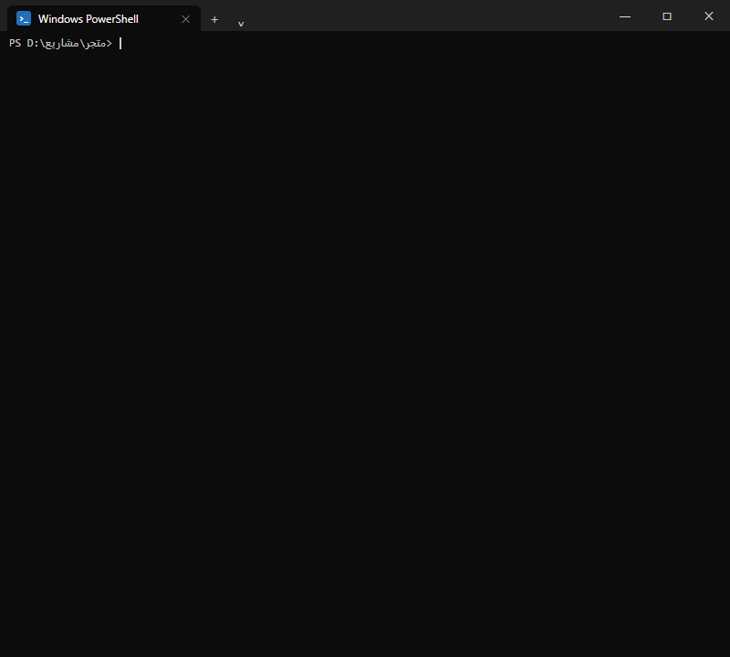

# pathdoc

**يتعطل البناء على Windows لديك لأن اسم أحد المجلدات ليس باللغة الإنجليزية. يحدد pathdoc موضع المشكلة، ويخبرك بالأداة التي تتعطل وسبب ذلك، ثم يعالج المشكلة. ويمكن التراجع عن كل تغيير.**

<p align="center">
  
</p>

<p align="center"><a href="../README.md">English</a> · <a href="README.zh-CN.md">中文</a> · العربية · <a href="README.ru.md">Русский</a> · <a href="README.ja.md">日本語</a></p>

لا تزال Java وGradle وAndroid Gradle Plugin وDart وPython تواجه مشكلات مع مسارات مثل `C:\Users\محمد` و`C:\Users\张伟` و`C:\Users\Иван` أو `D:\Projects\Café`. ولا تذكر رسالة الخطأ كلمة "path"، بل تعرض رسائل مثل `Could not find or load main class` و`Unable to write file` و`FormatException` و`UnicodeEncodeError` — ويوجد على GitHub أكثر من 11,000 مشكلة تتعلق بالأحرف غير ASCII في المسارات.

pathdoc عبارة عن ملف `.exe` واحد لا يحتاج إلى تثبيت. يقرأ صفحة الرموز (code page) وبيئة النظام وإصدارات الأدوات لديك (من ملفاتها، وليس عن طريق تشغيلها)، وفي جزء من الثانية يعرض فقط المشكلات التي ستحدث على **جهازك**: المسار، والأدوات التي ستتعطل بسببه، ورسالة الخطأ الدقيقة التي ستظهر لك، والدليل على ذلك.

## التثبيت

```powershell
irm https://raw.githubusercontent.com/Fd3os/pathdoc/main/install.ps1 | iex
```

يختار برنامج التثبيت الإصدار المناسب لمعالجك (x64 أو ARM64)، ويتحقق من قيمة SHA-256 بمقارنتها مع `SHA256SUMS.txt` الخاص بالإصدار، ثم يضع `pathdoc.exe` في `%LOCALAPPDATA%\Programs\pathdoc` ويضيف هذا المجلد إلى متغير `Path` الخاص بالمستخدم. لا تحتاج إلى صلاحيات المسؤول. أو يمكنك تنزيل ملف `.exe` من [الإصدارات](https://github.com/Fd3os/pathdoc/releases) وتشغيله من الطرفية.

Windows 10 أو 11.

## الاستخدام

```text
pathdoc          يفحص هذا الجهاز والمشروع الموجود في المجلد الحالي
pathdoc fix      يضبط متغيرات بيئة المستخدم التي تعالج المشكلات التي اكتشفها الفحص (يعرض خطة التنفيذ ويطلب التأكيد أولا)
pathdoc here     ينشئ وصلة junction بمسار ASCII لهذا المشروع ويعرض المسار الذي ينبغي تنفيذ البناء منه
pathdoc undo     يستعيد كل ما غيّره الأمران fix وhere
```

يطبع الخيار `--json` نتائج الفحص بصيغة مناسبة للبرامج النصية. يغيّر `--root DIR` موقع إنشاء الملفات بواسطة `fix` و`here` (الافتراضي `C:\dev`). ينفّذ `fix --yes` التغييرات دون طلب التأكيد، ويحدد `here --name NAME` اسم وصلة junction، كما يستعيد `undo --force` القيم التي غيّرتها بنفسك بعد تنفيذ `fix`. رموز الخروج: `0` لا توجد مشكلات، و`1` تم العثور على مشكلات، و`2` حدث خطأ في pathdoc نفسه.

## المشكلات التي يكتشفها

أُعيد إنتاج كل قاعدة على Windows 10 (صفحة الرموز 1252) داخل ثلاثة مجلدات: `plain` و`café` و`ابوي`. كما يُعاد اختبارها كل أسبوع على بيئة Windows في GitHub Actions، حيث يفشل الاختبار قبل تطبيق المعالجة وينجح بعدها ([`repro/`](../repro)، [سير العمل](../.github/workflows/repro.yml)).

هناك نوعان من مسببات المشكلة:

**أحرف غير مدعومة في صفحة الرموز لديك:** أي حرف لا تستطيع صفحة الرموز ANSI في Windows كتابته. تتسبب الأحرف العربية في مشكلات على الأنظمة ذات الإعدادات الأوروبية الغربية، بينما لا تسبب `café` مشكلة، وكذلك الأحرف العربية على نظام يستخدم إعدادات اللغة العربية (صفحة الرموز 1256).

**أي أحرف غير ASCII:** حتى `café` قد يتسبب في المشكلة.

> **على Windows باللغة العربية:** وفقا لقواعد pathdoc، لا تؤدي الأحرف العربية في المسار إلى تفعيل القواعد `gradle-project-path` و`gradle-user-home` و`python-pipe-encoding`، لأن صفحة الرموز 1256 تستطيع كتابة الأحرف العربية. لكن Android Gradle Plugin وDart AOT (`build_runner` و`TEMP` عند استخدام `dart compile exe`) و`flutter analyze` في الإصدارات الأقدم من 3.50 تتعطل عند وجود أي حرف غير ASCII. أما على Windows باللغة الإنجليزية مع اسم مستخدم عربي، فقد تنطبق جميع القواعد. أُجريت الاختبارات في بيئة المختبر باستخدام صفحة الرموز 1252 فقط؛ إذا كان سلوك صفحة الرموز 1256 مختلفا لديك، فيرجى فتح مشكلة.

| القاعدة | متى تحدث المشكلة | ما ستراه | المعالجة | الدليل |
|---|---|---|---|---|
| `gradle-project-path` | عندما لا يكون مجلد المشروع ممثلا في صفحة الرموز لديك (مع تثبيت Java ووجود مشروع Gradle أو Android) | `Error: Could not find or load main class org.gradle.wrapper.GradleWrapperMain` — أو `Unable to access jarfile` عند استخدام wrapper الخاص بـ Gradle 9 | `pathdoc here` | [JDK-4488646](https://bugs.openjdk.org/browse/JDK-4488646)، [اختبار إعادة الإنتاج](../repro/gradle_test.go) |
| `android-project-path` | عندما يحتوي مسار مجلد مشروع Android على أي حرف غير ASCII؛ إذ يفحص Android Gradle Plugin المسار نفسه (مع تثبيت Java أو Flutter) | `Your project path contains non-ASCII characters. This will most likely cause the build to fail on Windows.` | `pathdoc here` | [اختبار إعادة الإنتاج](../repro/android_test.go) |
| `gradle-user-home` | عندما لا يكون مسار مجلد Gradle الرئيسي (`%USERPROFILE%\.gradle` أو `GRADLE_USER_HOME`) ممثلا في صفحة الرموز لديك | `Error opening zip file or JAR manifest missing` (then `agent library failed …: instrument`) | `pathdoc fix`: `GRADLE_USER_HOME=C:\dev\gradle` | [JDK-4488646](https://bugs.openjdk.org/browse/JDK-4488646)، [godot#84196](https://github.com/godotengine/godot/issues/84196)، [اختبار إعادة الإنتاج](../repro/gradle_test.go) |
| `dart-temp` | عندما يحتوي `TEMP` على أي حرف غير ASCII (مع تثبيت Dart أو Flutter) | `dart compile exe`: `Generating AOT snapshot failed!` | `pathdoc fix`: تعيين `TEMP` و`TMP` إلى `C:\dev\temp` | [اختبار إعادة الإنتاج](../repro/dart_test.go) |
| `dart-aot-output` | عندما يحتوي مجلد مشروع Dart على أي حرف غير ASCII | `dart run build_runner` (مثل json_serializable وfreezed وriverpod وغيرها): `Unable to write file: …build.dart.aot` ثم `Failed to compile build script`؛ `dart compile aot-snapshot`: `Unable to write file … Generating AOT snapshot failed!` | `pathdoc here` | [اختبار إعادة الإنتاج](../repro/dart_test.go) |
| `flutter-analyze` | عندما يحتوي مجلد مشروع Flutter على أي حرف غير ASCII، وكان إصدار Flutter أقدم من 3.50.0 | `flutter analyze`: `FormatException: Unexpected end of input` | `pathdoc here` أو `flutter upgrade` | [flutter#191309](https://github.com/flutter/flutter/issues/191309)، [#192079](https://github.com/flutter/flutter/issues/192079)، تم الإصلاح في [#191377](https://github.com/flutter/flutter/pull/191377)، [اختبار إعادة الإنتاج](../repro/flutter_test.go) |
| `python-pipe-encoding` | عندما لا يكون مجلد Python أو أحد مشاريع Python ممثلا في صفحة الرموز لديك، ويكون إصدار Python أقدم من 3.15، مع التقاط المخرجات بواسطة بيئة تطوير متكاملة (IDE) أو CI أو pipe | `UnicodeEncodeError: 'charmap' codec can't encode characters` | `pathdoc fix`: `PYTHONUTF8=1` | [PEP 686](https://peps.python.org/pep-0686/)، [pip#11798](https://github.com/pypa/pip/issues/11798)، [اختبار إعادة الإنتاج](../repro/python_test.go) |

لا يتم تفعيل أي قاعدة إلا إذا كانت الأداة المعنية مثبتة لديك، وتتوقف القاعدة عن التحذير عند استخدام الإصدار الذي أصلح فيه المشروع الأصلي المشكلة.

### تم التحقق منها، ولا توجد مشكلة

المجلدات الثلاثة نفسها، والجهاز نفسه، دون أي إخفاق — لذلك لا يصدر pathdoc أي تحذير بشأن الحالات التالية:

- `dart compile exe` عندما يكون المشروع نفسه داخل مجلد يحتوي على أحرف غير ASCII.
- `PUB_CACHE` عندما يكون مساره غير ASCII.
- `adb keygen` و`emulator -list-avds` عند استخدام مجلد رئيسي لمستخدم Android يحتوي مساره على أحرف غير ASCII.

أما التقارير القديمة التي عالجتها المشاريع الأصلية لاحقا، فلا تُعد قواعد أيضا: [pip#3463](https://github.com/pypa/pip/issues/3463)، [dotnet/sdk#9464](https://github.com/dotnet/sdk/issues/9464)، [rustup#5035](https://github.com/rust-lang/rustup/issues/5035)، [electron-builder#5134](https://github.com/electron-userland/electron-builder/issues/5134)، [gradle#3117](https://github.com/gradle/gradle/issues/3117). لم يتم اختبار .NET حتى الآن.

## ما لن يفعله pathdoc مطلقا

- لن يطلب صلاحيات المسؤول.
- لن يلمس ملفاتك أو ينقلها أو يحذفها.
- لن يتصل بالإنترنت. لا توجد اتصالات بالشبكة ولا جمع لبيانات الاستخدام.

لا ينشئ `fix` سوى مجلدات جديدة داخل `C:\dev`، ويضبط متغيرات بيئة **المستخدم** (`HKCU\Environment`) بعد عرض خطة التنفيذ الدقيقة عليك. أما `here` فلا ينشئ سوى وصلة junction داخل `C:\dev\p`. يتم تسجيل كل تغيير والقيمة التي استبدلها في `%LOCALAPPDATA%\pathdoc\state.json`، ويعيد `pathdoc undo` القيم السابقة. إذا غيّرت قيمة بنفسك بعد تنفيذ `fix`، فسيُبقي `undo` على قيمتك الجديدة ويخبرك بذلك.

بعد تنفيذ `fix`، ستعيد الأدوات إنشاء ذاكرات التخزين المؤقت (caches) في المجلدات الجديدة، ولذلك ستكون عملية البناء التالية أبطأ لمرة واحدة. نفّذ البناء انطلاقا من وصلة `here` باستخدام PowerShell أو cmd؛ إذ يتبع Git Bash الوصلة ويعود إلى المسار الحقيقي. وينبغي تنفيذ عمليات البناء باستخدام npm وVite من المجلد الحقيقي، لأن Node يعيد أيضا حل الوصلة إلى المسار الأصلي.

## كيف تتم إضافة قاعدة جديدة؟

لا تُضاف أي قاعدة إلا بعد إثباتها عمليا: يجب أن يتوفر اختبار Go داخل [`repro/`](../repro) يشغّل الأداة الحقيقية داخل مجلد غير ASCII، ويتحقق من فشلها مع ظهور رسالة الخطأ الدقيقة، ثم يطبق المعالجة ويتحقق من نجاحها.

يفشل التشغيل الأسبوعي على `windows-latest` عندما يتوقف اختبار "before" عن الفشل. وبهذه الطريقة يعرف pathdoc أن المشروع الأصلي قد أصلح مشكلة ما، ويتوقف عن إصدار التحذيرات المتعلقة بها.

هل عثرت على مشكلة في المسارات لا يكتشفها pathdoc؟ افتح مشكلة جديدة واذكر الأداة وإصدارها ورسالة الخطأ الدقيقة وصفحة الرموز لديك (`chcp` أو السطر الأول من `pathdoc`). وأسرع طريقة لإضافة قاعدة هي إرسال طلب دمج (Pull Request) يتضمن اختبارا باسم يبدأ بـ `TestRepro_`.

## غير موقّع رقميا، مع التحقق من سلامته وإمكانية إعادة بنائه

ملف `.exe` غير موقّع رقميا. إذا منعك Windows SmartScreen من تشغيله، فاختر **مزيد من المعلومات ← التشغيل على أي حال**، أو تحقق منه أولا: يحتوي كل إصدار على الملف `SHA256SUMS.txt`، كما أن عملية البناء قابلة لإعادة الإنتاج.

على Windows مع تثبيت Go، تعيد الأوامر التالية بناء الإصدار بالبايتات نفسها (سيقوم Go بتنزيل الإصدار 1.26.5 بنفسه إذا كان إصدارك مختلفا):

```powershell
git clone --branch v0.1.0 https://github.com/Fd3os/pathdoc; cd pathdoc
$env:GOTOOLCHAIN = "go1.26.5"; $env:CGO_ENABLED = "0"; $env:GOARCH = "amd64"
go build -trimpath -ldflags "-s -w -buildid= -X github.com/Fd3os/pathdoc/internal/cli.Version=v0.1.0" -o pathdoc-windows-amd64.exe ./cmd/pathdoc
(Get-FileHash pathdoc-windows-amd64.exe -Algorithm SHA256).Hash
```

## الترخيص

MIT. إن Gradle wrapper الموجود في `repro/testdata` هو ملك لمشروع Gradle نفسه، ويخضع لترخيص Apache-2.0 (راجع ملف `NOTICE` الخاص به).
