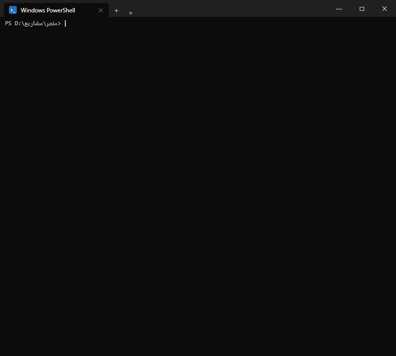

# pathdoc

**Windows でフォルダー名が英語でないだけで、ビルドが壊れます。pathdoc はどこで壊れるのか、どのツールがなぜ壊れるのかを示し、修正します。変更はすべて元に戻せます。**

<p align="center">
  
</p>

<p align="center"><a href="../README.md">English</a> · <a href="README.zh-CN.md">中文</a> · <a href="README.ar.md">العربية</a> · <a href="README.ru.md">Русский</a> · 日本語</p>

Java、Gradle、Android Gradle Plugin、Dart、Python は、`C:\Users\山田`、`C:\Users\محمد`、`C:\Users\Иван`、`D:\Projects\Café` のようなパスで今も壊れます。エラーは「パス」とは決して言いません。`Could not find or load main class`、`Unable to write file`、`FormatException`、`UnicodeEncodeError` と言うだけです。GitHub にはパス中の非 ASCII 文字に関する issue が 11,000 件以上あります。

pathdoc はインストール不要の `.exe` ひとつです。コードページ、環境変数、各ツールのバージョン（ツールを実行せず、ファイルから読み取ります）を読み、**あなたのマシンで**実際に壊れるものだけを一瞬で報告します。どのパスか、どのツールが壊れるか、表示される正確なエラー、そしてその証拠です。

## インストール

```powershell
irm https://raw.githubusercontent.com/Fd3os/pathdoc/main/install.ps1 | iex
```

インストーラーは CPU（x64 または ARM64）に合ったビルドを選び、リリースの `SHA256SUMS.txt` で SHA-256 を検証し、`pathdoc.exe` を `%LOCALAPPDATA%\Programs\pathdoc` に置いて、そのフォルダーをユーザーの `Path` に追加します。管理者権限は不要です。[Releases](https://github.com/Fd3os/pathdoc/releases) から `.exe` を取得してターミナルで実行することもできます。

Windows 10 / 11 対応。

## 使い方

```text
pathdoc          このマシンと、このフォルダーのプロジェクトを検査する
pathdoc fix      検査で見つかった問題を直すユーザー環境変数を設定する（先に計画を示して確認する）
pathdoc here     プロジェクトへの ASCII パスのジャンクションを作り、どこからビルドすればよいかを示す
pathdoc undo     fix と here が変えたものをすべて元に戻す
```

`--json` は検査結果をスクリプト向けに出力します。`--root DIR` は `fix` と `here` が使う場所を変えます（既定は `C:\dev`）。`fix --yes` は確認なしで適用し、`here --name NAME` はジャンクション名を指定し、`undo --force` は `fix` の後に自分で変えた値も戻します。終了コード：`0` 問題なし、`1` 問題あり、`2` pathdoc 自体の失敗。

## 見つけるもの

各ルールは Windows 10（コードページ 1252）上で `plain`、`café`、`ابوي` の 3 つのフォルダーを使って再現済みで、GitHub Actions の Windows ランナーで毎週あらためて再現しています。対処の前は失敗し、対処の後は成功しなければなりません（[`repro/`](../repro)、[workflow](../.github/workflows/repro.yml)）。

条件は 2 種類です。**コードページにない文字**：Windows の ANSI コードページで書けない文字。西欧の言語設定ではアラビア文字は壊れますが `café` は壊れません。日本語の言語設定（コードページ 932）なら日本語も壊れません。**あらゆる非 ASCII 文字**：`café` でさえ壊れます。

> **日本語版 Windows では：** pathdoc のルール上、日本語のパスは `gradle-project-path`、`gradle-user-home`、`python-pipe-encoding` を起こしません。コードページ 932 で書けるからです。ただし Android Gradle Plugin、Dart の AOT（`build_runner`、`dart compile exe` の TEMP）、3.50 より前の `flutter analyze` は、非 ASCII 文字が一つでもあれば失敗します。英語版 Windows で日本語のユーザー名を使っている場合は、すべてのルールが当てはまり得ます。実験はコードページ 1252 でのみ行っています。932 で違う結果が出たら issue を立ててください。

| ルール | 壊れる条件 | 表示されるもの | 対処 | 証拠 |
|---|---|---|---|---|
| `gradle-project-path` | プロジェクトのフォルダーにコードページにない文字がある（Java があり、Gradle か Android のプロジェクト） | `Error: Could not find or load main class org.gradle.wrapper.GradleWrapperMain`。Gradle 9 自身の wrapper なら `Unable to access jarfile` | `pathdoc here` | [JDK-4488646](https://bugs.openjdk.org/browse/JDK-4488646)、[repro](../repro/gradle_test.go) |
| `android-project-path` | Android プロジェクトのフォルダーに非 ASCII 文字がある。Android Gradle Plugin が自分でパスを検査する（Java か Flutter がある） | `Your project path contains non-ASCII characters. This will most likely cause the build to fail on Windows.` | `pathdoc here` | [repro](../repro/android_test.go) |
| `gradle-user-home` | Gradle のホーム（`%USERPROFILE%\.gradle` または `GRADLE_USER_HOME`）にコードページにない文字がある | `agent library failed to init: instrument` | `pathdoc fix`：`GRADLE_USER_HOME=C:\dev\gradle` | [JDK-4488646](https://bugs.openjdk.org/browse/JDK-4488646)、[godot#84196](https://github.com/godotengine/godot/issues/84196)、[repro](../repro/gradle_test.go) |
| `dart-temp` | `TEMP` に非 ASCII 文字がある（Dart か Flutter がある） | `dart compile exe`：`Generating AOT snapshot failed!` | `pathdoc fix`：`TEMP` と `TMP` = `C:\dev\temp` | [repro](../repro/dart_test.go) |
| `dart-aot-output` | Dart プロジェクトのフォルダーに非 ASCII 文字がある | `dart run build_runner`（json_serializable、freezed、riverpod など）：`Unable to write file: …build.dart.aot` の後に `Failed to compile build script`。`dart compile aot-snapshot`：`Unable to write file … Generating AOT snapshot failed!` | `pathdoc here` | [repro](../repro/dart_test.go) |
| `flutter-analyze` | Flutter プロジェクトのフォルダーに非 ASCII 文字があり、Flutter が 3.50.0 より古い | `flutter analyze`：`FormatException: Unexpected end of input` | `pathdoc here` または `flutter upgrade` | [flutter#191309](https://github.com/flutter/flutter/issues/191309)、[#192079](https://github.com/flutter/flutter/issues/192079)、[#191377](https://github.com/flutter/flutter/pull/191377) で修正、[repro](../repro/flutter_test.go) |
| `python-pipe-encoding` | Python のフォルダーか Python プロジェクトにコードページにない文字があり、Python が 3.15 より古く、出力を IDE・CI・パイプが受け取る | `UnicodeEncodeError: 'charmap' codec can't encode characters` | `pathdoc fix`：`PYTHONUTF8=1` | [PEP 686](https://peps.python.org/pep-0686/)、[pip#11798](https://github.com/pypa/pip/issues/11798)、[repro](../repro/python_test.go) |

ルールはインストール済みのツールにだけ反応し、上流で修正されたバージョンからは報告しなくなります。

### 検査して、問題がなかったもの

同じ 3 つのフォルダー、同じマシンで失敗しなかったので、pathdoc はこれらについて何も言いません：

- プロジェクト自体が非 ASCII のフォルダーにあるときの `dart compile exe`
- 非 ASCII のパスにある `PUB_CACHE`
- Android のユーザーホームが非 ASCII のときの `adb keygen` と `emulator -list-avds`

上流ですでに修正された古い報告もルールにしていません：[pip#3463](https://github.com/pypa/pip/issues/3463)、[dotnet/sdk#9464](https://github.com/dotnet/sdk/issues/9464)、[rustup#5035](https://github.com/rust-lang/rustup/issues/5035)、[electron-builder#5134](https://github.com/electron-userland/electron-builder/issues/5134)、[gradle#3117](https://github.com/gradle/gradle/issues/3117)。.NET はまだ検査していません。

## pathdoc が決してしないこと

- 管理者権限を求めること。
- あなたのファイルに触れること、移動すること、削除すること。
- ネットワークにつなぐこと。通信もテレメトリーも一切ありません。

`fix` は `C:\dev` の下に新しいフォルダーを作り、**ユーザー**環境変数（`HKCU\Environment`）を設定するだけで、その前に正確な計画を見せます。`here` は `C:\dev\p` の下にジャンクションを一つ作るだけです。すべての変更と、それが置き換えた値は `%LOCALAPPDATA%\pathdoc\state.json` に記録され、`pathdoc undo` で元に戻ります。`fix` の後に自分で値を変えた場合、`undo` はあなたの値を残し、そのことを伝えます。

`fix` の後、各ツールは新しいフォルダーでキャッシュを作り直すので、次のビルドは一度だけ遅くなります。`here` のジャンクションからのビルドは PowerShell か cmd で行ってください。Git Bash はジャンクションをたどって元のパスに戻ってしまいます。npm と Vite のビルドは元のフォルダーで実行してください。Node もジャンクションを元のパスに解決するためです。

## ルールが加わる条件

再現があることだけです。[`repro/`](../repro) の Go テストが本物のツールを非 ASCII のフォルダーで実行し、正確なエラーで失敗するのを確かめ、対処を適用し、成功するのを確かめます。`windows-latest` での週次実行は「対処前」が失敗しなくなると失敗します。pathdoc はこうして上流の修正を知り、警告をやめます。

pathdoc が見逃しているパスの問題を見つけたら、ツール、バージョン、正確なエラー、コードページ（`chcp`、または `pathdoc` の出力の 1 行目）を添えて issue を立ててください。`TestRepro_` テスト付きのプルリクエストがいちばんの近道です。

## 署名なし、チェックサムあり、再現可能

`.exe` にはコード署名がありません。Windows SmartScreen に止められたら **詳細情報 → 実行** を選ぶか、先に確認してください。どのリリースにも `SHA256SUMS.txt` があり、ビルドは再現可能です。Go の入った Windows なら、次のコマンドでリリースとバイト単位で同じファイルができます（Go のバージョンが違えば、Go が 1.26.5 を自動で取得します）：

```powershell
git clone --branch v0.1.0 https://github.com/Fd3os/pathdoc; cd pathdoc
$env:GOTOOLCHAIN = "go1.26.5"; $env:CGO_ENABLED = "0"; $env:GOARCH = "amd64"
go build -trimpath -ldflags "-s -w -buildid= -X github.com/Fd3os/pathdoc/internal/cli.Version=v0.1.0" -o pathdoc-windows-amd64.exe ./cmd/pathdoc
(Get-FileHash pathdoc-windows-amd64.exe -Algorithm SHA256).Hash
```

## ライセンス

MIT。`repro/testdata` の Gradle wrapper は Gradle 自身のもので、Apache-2.0 ライセンスです（`NOTICE` を参照）。
