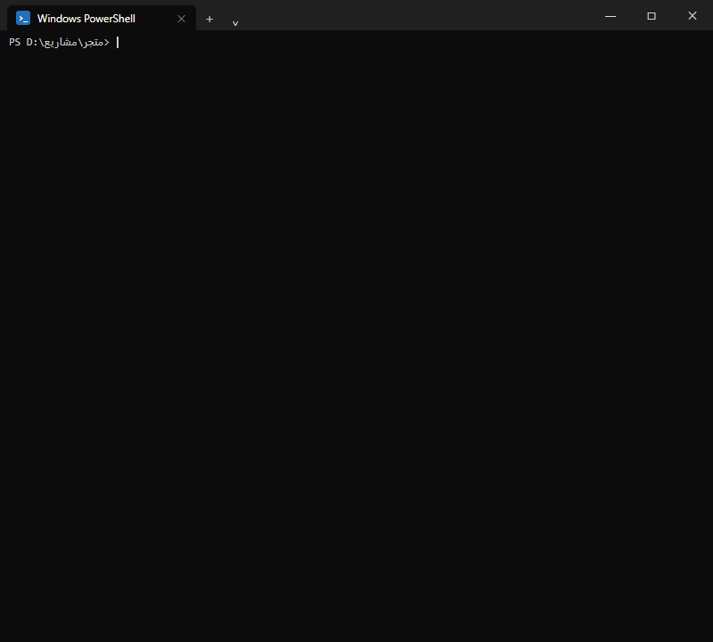

# pathdoc

**Сборка в Windows ломается, потому что в имени папки есть не английские буквы. pathdoc находит, где именно, называет инструмент, который сломается, и причину, и лечит: меняет за вас пользовательскую настройку или даёт ASCII-путь, из которого можно собирать. Любое изменение можно откатить.**

<p align="center">
  
</p>

<p align="center"><a href="../README.md">English</a> · <a href="README.zh-CN.md">中文</a> · <a href="README.ar.md">العربية</a> · Русский · <a href="README.ja.md">日本語</a></p>

Java, Gradle, Android Gradle Plugin, Dart и Python до сих пор ломаются на путях вроде `C:\Users\Иван`, `C:\Users\محمد`, `C:\Users\张伟` или `D:\Projects\Café`. Ошибка никогда не говорит «путь». Она говорит `Could not find or load main class`, `Unable to write file`, `FormatException`, `UnicodeEncodeError`. Поиск по GitHub «non-ASCII characters in path» находит больше 11 000 issues.

pathdoc — один `.exe`, ставить ничего не нужно. Он читает кодовую страницу, переменные окружения и версии инструментов (из их файлов, никогда не запуская сами инструменты) и за долю секунды сообщает только о том, что сломается **на вашей** машине: путь, какие инструменты на нём падают, точный текст ошибки и доказательство.

## Установка

```powershell
irm https://raw.githubusercontent.com/Fd3os/pathdoc/main/install.ps1 | iex
```

Установщик берёт сборку под ваш процессор (x64 или ARM64), сверяет её SHA-256 с файлом `SHA256SUMS.txt` из релиза, кладёт `pathdoc.exe` в `%LOCALAPPDATA%\Programs\pathdoc` и добавляет эту папку в пользовательский `Path`. Права администратора не нужны. Или скачайте `.exe` со страницы [Releases](https://github.com/Fd3os/pathdoc/releases) и запустите его из терминала.

Windows 10 или 11.

## Использование

```text
pathdoc          проверить эту машину и проект в текущей папке
pathdoc fix      задать пользовательские переменные окружения, которые лечат найденное (сначала показывает план и спрашивает)
pathdoc here     создать для проекта связь каталогов (junction) с ASCII-путём и сказать, откуда собирать
pathdoc undo     вернуть всё, что изменили fix и here
```

`--json` выводит результат проверки для скриптов. `--root DIR` меняет место, куда `fix` и `here` кладут свои папки (по умолчанию `C:\dev`). `fix --yes` применяет без вопроса, `here --name NAME` задаёт имя связи, `undo --force` возвращает и те значения, которые вы сами поменяли после `fix`. Коды выхода: `0` всё чисто, `1` найдены проблемы, `2` ошибка самого pathdoc.

## Что он находит

Каждое правило воспроизведено в Windows 10 (кодовая страница 1252) в трёх папках — `plain`, `café` и `ابوي` — и воспроизводится заново каждую неделю на Windows-раннере GitHub Actions: до лечения оно обязано падать, после лечения — проходить ([`repro/`](../repro), [workflow](../.github/workflows/repro.yml)).

Триггеров два вида. **Нет в кодовой странице:** символ, который ваша ANSI-кодовая страница Windows не может записать. На западноевропейской системе ломает арабский, а `café` — нет; на русской системе (кодовая страница 1251) кириллица тоже не ломает. **Любой не-ASCII:** ломает даже `café`.

> **В русской Windows:** по правилам pathdoc кириллица в пути не включает `gradle-project-path`, `gradle-user-home` и `python-pipe-encoding`, потому что 1251 её записывает. Но Android Gradle Plugin, Dart AOT (`build_runner`, `TEMP` для `dart compile exe`) и `flutter analyze` до 3.50 падают на любом не-ASCII символе. В английской Windows с кириллическим именем пользователя могут сработать все правила. Опыты проводились только на кодовой странице 1252; если на 1251 у вас выходит иначе — откройте issue.

| Правило | Когда ломается | Что вы увидите | Лечение | Доказательство |
|---|---|---|---|---|
| `gradle-project-path` | в папке проекта есть символ не из кодовой страницы (Java установлена, проект Gradle или Android) | `Error: Could not find or load main class org.gradle.wrapper.GradleWrapperMain` — или, от собственного wrapper Gradle 9, `Unable to access jarfile` | `pathdoc here` | [JDK-4488646](https://bugs.openjdk.org/browse/JDK-4488646), [repro](../repro/gradle_test.go) |
| `android-project-path` | в папке Android-проекта есть любая не-ASCII буква: Android Gradle Plugin проверяет путь сам (установлена Java или Flutter) | `Your project path contains non-ASCII characters. This will most likely cause the build to fail on Windows.` | `pathdoc here` | [repro](../repro/android_test.go) |
| `gradle-user-home` | в домашней папке Gradle (`%USERPROFILE%\.gradle` или `GRADLE_USER_HOME`) есть символ не из кодовой страницы | `Error opening zip file or JAR manifest missing` (then `agent library failed …: instrument`) | `pathdoc fix`: `GRADLE_USER_HOME=C:\dev\gradle` | [JDK-4488646](https://bugs.openjdk.org/browse/JDK-4488646), [godot#84196](https://github.com/godotengine/godot/issues/84196), [repro](../repro/gradle_test.go) |
| `dart-temp` | в `TEMP` есть любая не-ASCII буква (установлен Dart или Flutter) | `dart compile exe`: `Generating AOT snapshot failed!` | `pathdoc fix`: `TEMP` и `TMP` = `C:\dev\temp` | [repro](../repro/dart_test.go) |
| `dart-aot-output` | в папке Dart-проекта есть любая не-ASCII буква | `dart run build_runner` (json_serializable, freezed, riverpod…): `Unable to write file: …build.dart.aot`, затем `Failed to compile build script`; `dart compile aot-snapshot`: `Unable to write file … Generating AOT snapshot failed!` | `pathdoc here` | [repro](../repro/dart_test.go) |
| `flutter-analyze` | в папке Flutter-проекта есть любая не-ASCII буква, Flutter старше 3.50.0 | `flutter analyze`: `FormatException: Unexpected end of input` | `pathdoc here` или `flutter upgrade` | [flutter#191309](https://github.com/flutter/flutter/issues/191309), [#192079](https://github.com/flutter/flutter/issues/192079), исправлено в [#191377](https://github.com/flutter/flutter/pull/191377), [repro](../repro/flutter_test.go) |
| `python-pipe-encoding` | в папке Python или Python-проекта есть символ не из кодовой страницы, Python старше 3.15, вывод перехватывают IDE, CI или конвейер | `UnicodeEncodeError: 'charmap' codec can't encode characters` | `pathdoc fix`: `PYTHONUTF8=1` | [PEP 686](https://peps.python.org/pep-0686/), [pip#11798](https://github.com/pypa/pip/issues/11798), [repro](../repro/python_test.go) |

Правило срабатывает только для установленных у вас инструментов и замолкает с той версии, в которой проблему исправили.

### Проверено, всё в порядке

Те же три папки, та же машина, никаких ошибок — поэтому pathdoc о них молчит:

- `dart compile exe`, когда сам проект лежит в папке с не-ASCII именем
- `PUB_CACHE` на не-ASCII пути
- `adb keygen` и `emulator -list-avds` с не-ASCII домашней папкой Android
- **Веб-проекты на Node 24:** `npm install`, `vite build`, `next build`, Tailwind 4, `prisma generate` и sharp — проект, кэш npm и `TEMP` в каждой из трёх папок, всё прошло. Node правильно работает с Unicode-путями, поэтому для веб-проекта pathdoc называет Node среди проверенных инструментов и молчит. Еженедельный тест следит, чтобы так и оставалось, и собирает нативный модуль через node-gyp на Visual Studio раннера.

Старые баги, которые уже исправлены, тоже не стали правилами: [pip#3463](https://github.com/pypa/pip/issues/3463), [dotnet/sdk#9464](https://github.com/dotnet/sdk/issues/9464), [rustup#5035](https://github.com/rust-lang/rustup/issues/5035), [electron-builder#5134](https://github.com/electron-userland/electron-builder/issues/5134), [gradle#3117](https://github.com/gradle/gradle/issues/3117). .NET пока не проверялся.

## Чего pathdoc не сделает никогда

- Не попросит прав администратора.
- Не тронет, не переместит и не удалит ни один ваш файл.
- Не пойдёт в сеть. Никаких сетевых запросов, никакой телеметрии.

`fix` только создаёт новые папки в `C:\dev` и задаёт **пользовательские** переменные окружения (`HKCU\Environment`), предварительно показав точный план. `here` только создаёт связь каталогов в `C:\dev\p`. Каждое изменение и значение, которое оно заменило, записываются в `%LOCALAPPDATA%\pathdoc\state.json`, и `pathdoc undo` всё возвращает. Если после `fix` вы сами поменяли значение, `undo` оставит ваше и скажет об этом. Папки, которые создаёт `fix`, доступны только вашей учётной записи (другие пользователи компьютера не могут писать в созданные pathdoc TEMP или домашнюю папку Gradle). Эти переменные действуют для всего пользователя: новый `TEMP` получат все программы, которые вы запускаете, а `PYTHONUTF8=1` заставит все Python-скрипты читать и писать UTF-8 по умолчанию, как в Python 3.15. Лечение двух видов: `pathdoc fix` один раз меняет пользовательскую настройку; `pathdoc here` даёт проекту ASCII-путь, и дальше собирать (и открывать в Android Studio или VS Code) нужно из него. Python из Microsoft Store пока не обнаруживается.

После `fix` инструменты заново строят кеши в новых папках, поэтому следующая сборка один раз будет медленнее. Собирайте из связи, созданной `here`, в PowerShell или cmd: Git Bash переходит по связи обратно к настоящему пути. Сборки npm и Vite запускайте из настоящей папки, потому что Node тоже разворачивает связь обратно.

## Как правило попадает в каталог

Только с воспроизведением: Go-тест в [`repro/`](../repro), который запускает настоящий инструмент в не-ASCII папке, видит падение с точной ошибкой, применяет лечение и видит успех. Еженедельный прогон на `windows-latest` падает, если «до» перестало падать, — так pathdoc узнаёт, что проблему исправили, и перестаёт о ней предупреждать.

Нашли ошибку пути, которую pathdoc пропускает? Откройте issue: инструмент, его версия, точный текст ошибки и ваша кодовая страница (`chcp` или первая строка вывода `pathdoc`). Быстрее всего — pull request с тестом `TestRepro_`.

## Без подписи, с контрольными суммами, воспроизводимо

`.exe` не подписан. Если Windows SmartScreen его остановит, выберите **Подробнее → Выполнить в любом случае** — или сначала проверьте: в каждом релизе есть `SHA256SUMS.txt` (он из того же релиза, поэтому ловит битую загрузку, но не подменённый релиз — от этого защищает пересборка), а сборка воспроизводима. В Windows с установленным Go эти команды собирают релиз байт в байт (если ваша версия Go другая, Go сам скачает 1.26.5):

```powershell
git clone --branch v0.1.1 https://github.com/Fd3os/pathdoc; cd pathdoc
$env:GOTOOLCHAIN = "go1.26.5"; $env:CGO_ENABLED = "0"; $env:GOARCH = "amd64"
go build -trimpath -ldflags "-s -w -buildid= -X github.com/Fd3os/pathdoc/internal/cli.Version=v0.1.1" -o pathdoc-windows-amd64.exe ./cmd/pathdoc
(Get-FileHash pathdoc-windows-amd64.exe -Algorithm SHA256).Hash
```

## Лицензия

MIT. Gradle wrapper в `repro/testdata` — собственный wrapper Gradle под лицензией Apache-2.0 (см. его `NOTICE`).
