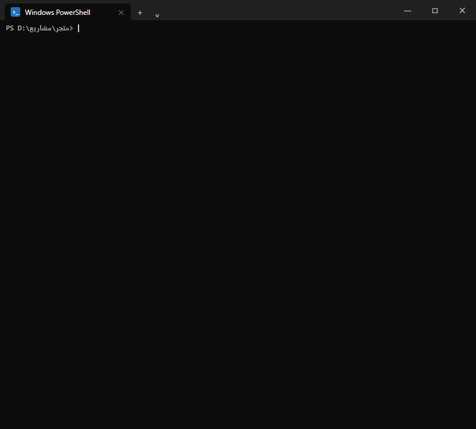

# pathdoc

**在 Windows 上，文件夹名不是英文就可能让构建失败。pathdoc 找出会出问题的地方，告诉你是哪个工具、为什么，并给出解决办法：替你改一项用户设置，或给出一个可以构建的 ASCII 路径。每一项改动都能撤销。**

<p align="center">
  
</p>

<p align="center"><a href="../README.md">English</a> · 中文 · <a href="README.ar.md">العربية</a> · <a href="README.ru.md">Русский</a> · <a href="README.ja.md">日本語</a></p>

Java、Gradle、Android Gradle 插件、Dart 和 Python 遇到 `C:\Users\张伟`、`C:\Users\محمد`、`C:\Users\Иван` 或 `D:\Projects\Café` 这样的路径时，至今仍会出错。报错从不提“路径”，只会说 `Could not find or load main class`、`Unable to write file`、`FormatException`、`UnicodeEncodeError`。在 GitHub 上搜索 “non-ASCII characters in path”，能找到超过 11,000 个 issue。

pathdoc 只是一个 `.exe`，不需要安装任何运行时。它读取你的代码页、环境变量和各个工具的版本（从文件里读，从不运行这些工具），一眨眼就报告在**你这台机器上**真正会出问题的地方：哪个路径、会让哪些工具失败、你会看到的确切报错，以及证据。

## 安装

```powershell
irm https://raw.githubusercontent.com/Fd3os/pathdoc/main/install.ps1 | iex
```

安装脚本会按你的 CPU（x64 或 ARM64）下载对应的版本，用发布页的 `SHA256SUMS.txt` 校验 SHA-256，把 `pathdoc.exe` 放进 `%LOCALAPPDATA%\Programs\pathdoc`，并把这个目录加入用户 `Path`。不需要管理员权限。也可以直接从 [Releases](https://github.com/Fd3os/pathdoc/releases) 下载 `.exe`，在终端里运行。

支持 Windows 10 和 11。

## 用法

```text
pathdoc          检查本机，以及当前文件夹里的项目
pathdoc fix      设置用户环境变量，修好检查发现的问题（先列出计划，征得同意）
pathdoc here     为当前项目建一个纯 ASCII 路径的目录联接（junction），并告诉你从哪里构建
pathdoc undo     撤销 fix 和 here 做过的一切
```

`--json` 以 JSON 输出检查结果，方便脚本使用。`--root DIR` 指定 `fix` 和 `here` 的存放位置（默认 `C:\dev`）。`fix --yes` 不询问直接执行，`here --name NAME` 指定联接的名字，`undo --force` 连你在 `fix` 之后自己改过的值也一并恢复。退出码：`0` 没有问题，`1` 发现问题，`2` pathdoc 自身出错。

## 能发现什么

每条规则都在 Windows 10（代码页 1252）上用三个文件夹复现过：`plain`、`café` 和 `ابوي`；并且每周在 GitHub Actions 的 Windows runner 上再复现一次：施治前必须失败，施治后必须通过（[`repro/`](../repro)、[workflow](../.github/workflows/repro.yml)）。

触发条件分两种。**代码页写不出的字符**：你的 Windows ANSI 代码页无法表示的字符。在西欧语言的系统上阿拉伯文会出错，`café` 不会；在中文系统（代码页 936）上，中文也不会。**任何非 ASCII 字符**：连 `café` 都会出错。

> **在中文版 Windows 上**：按 pathdoc 的规则，中文路径不会触发 `gradle-project-path`、`gradle-user-home` 和 `python-pipe-encoding`，因为代码页 936 写得出中文；但 Android Gradle 插件、Dart AOT（`build_runner`、`dart compile exe` 的 TEMP）和 3.50 之前的 `flutter analyze` 遇到任何非 ASCII 字符都会失败。用英文版 Windows、用户名却是中文的话，所有规则都可能触发。实验只在代码页 1252 上做过；如果你在 936 上遇到了不同的结果，请提 issue。

| 规则 | 何时出错 | 你会看到 | 解决办法 | 证据 |
|---|---|---|---|---|
| `gradle-project-path` | 项目文件夹含有代码页写不出的字符（装了 Java，且是 Gradle 或 Android 项目） | `Error: Could not find or load main class org.gradle.wrapper.GradleWrapperMain`；Gradle 9 自带的 wrapper 则报 `Unable to access jarfile` | `pathdoc here` | [JDK-4488646](https://bugs.openjdk.org/browse/JDK-4488646)、[repro](../repro/gradle_test.go) |
| `android-project-path` | Android 项目的文件夹含有任何非 ASCII 字符：Android Gradle 插件会自己检查路径（装了 Java 或 Flutter） | `Your project path contains non-ASCII characters. This will most likely cause the build to fail on Windows.` | `pathdoc here` | [repro](../repro/android_test.go) |
| `gradle-user-home` | Gradle 主目录（`%USERPROFILE%\.gradle` 或 `GRADLE_USER_HOME`）含有代码页写不出的字符 | `Error opening zip file or JAR manifest missing` (then `agent library failed …: instrument`) | `pathdoc fix`：`GRADLE_USER_HOME=C:\dev\gradle` | [JDK-4488646](https://bugs.openjdk.org/browse/JDK-4488646)、[godot#84196](https://github.com/godotengine/godot/issues/84196)、[repro](../repro/gradle_test.go) |
| `dart-temp` | `TEMP` 含有任何非 ASCII 字符（装了 Dart 或 Flutter） | `dart compile exe`：`Generating AOT snapshot failed!` | `pathdoc fix`：`TEMP` 和 `TMP` = `C:\dev\temp` | [repro](../repro/dart_test.go) |
| `dart-aot-output` | Dart 项目文件夹含有任何非 ASCII 字符 | `dart run build_runner`（json_serializable、freezed、riverpod……）：`Unable to write file: …build.dart.aot`，接着 `Failed to compile build script`；`dart compile aot-snapshot`：`Unable to write file … Generating AOT snapshot failed!` | `pathdoc here` | [repro](../repro/dart_test.go) |
| `flutter-analyze` | Flutter 项目文件夹含有任何非 ASCII 字符，且 Flutter 低于 3.50.0 | `flutter analyze`：`FormatException: Unexpected end of input` | `pathdoc here`，或 `flutter upgrade` | [flutter#191309](https://github.com/flutter/flutter/issues/191309)、[#192079](https://github.com/flutter/flutter/issues/192079)，由 [#191377](https://github.com/flutter/flutter/pull/191377) 修复，[repro](../repro/flutter_test.go) |
| `python-pipe-encoding` | Python 所在文件夹或 Python 项目含有代码页写不出的字符，Python 低于 3.15，且输出被 IDE、CI 或管道捕获 | `UnicodeEncodeError: 'charmap' codec can't encode characters` | `pathdoc fix`：`PYTHONUTF8=1` | [PEP 686](https://peps.python.org/pep-0686/)、[pip#11798](https://github.com/pypa/pip/issues/11798)、[repro](../repro/python_test.go) |

规则只对你装了的工具生效；上游在哪个版本修好，规则就从那个版本起不再报告。

### 检查过、没问题的

同样三个文件夹、同一台机器，没有出错，所以 pathdoc 不会为它们报警：

- 项目本身在非 ASCII 文件夹里时的 `dart compile exe`
- 位于非 ASCII 路径的 `PUB_CACHE`
- Android 用户目录为非 ASCII 时的 `adb keygen` 和 `emulator -list-avds`
- **Node 24 上的网站项目：** `npm install`、`vite build`、`next build`、Tailwind 4、`prisma generate` 和 sharp，项目、npm 缓存和 `TEMP` 分别放在三个文件夹里，全部通过。Node 能正确处理 Unicode 路径，所以对网站项目 pathdoc 会把 Node 列为已检查的工具，不报警。每周的测试会继续验证这一点，并在 runner 的 Visual Studio 上用 node-gyp 编译一个原生模块。

上游已经修好的旧问题也不算规则：[pip#3463](https://github.com/pypa/pip/issues/3463)、[dotnet/sdk#9464](https://github.com/dotnet/sdk/issues/9464)、[rustup#5035](https://github.com/rust-lang/rustup/issues/5035)、[electron-builder#5134](https://github.com/electron-userland/electron-builder/issues/5134)、[gradle#3117](https://github.com/gradle/gradle/issues/3117)。.NET 还没有测试过。

## pathdoc 绝不会做的事

- 要求管理员权限。
- 修改、移动或删除你的任何文件。
- 联网。没有任何网络请求，也没有遥测。

`fix` 只会在 `C:\dev` 下新建文件夹，并设置**用户级**环境变量（`HKCU\Environment`），而且会先把完整计划给你看。`here` 只会在 `C:\dev\p` 下创建一个目录联接。每一项改动和它替换掉的值都记录在 `%LOCALAPPDATA%\pathdoc\state.json`，`pathdoc undo` 会把它们放回去。如果你在 `fix` 之后自己改过某个值，`undo` 会保留你的值，并告诉你。 `fix` 新建的文件夹只属于你的账户（同一台电脑上的其他账户无法往 pathdoc 建的 TEMP 或 Gradle 主目录里写东西）。这些变量对整个用户生效：新的 `TEMP` 会被你启动的所有程序使用，`PYTHONUTF8=1` 会让所有 Python 脚本默认按 UTF-8 读写，和 Python 3.15 一样。解决办法有两种：`pathdoc fix` 改一次用户设置就完事；`pathdoc here` 给项目一个 ASCII 路径，之后要从这个路径构建（在 Android Studio 或 VS Code 里也打开这个路径）。来自 Microsoft Store 的 Python 暂时检测不到。

`fix` 之后，各个工具会在新文件夹里重建缓存，所以下一次构建会慢一次。请在 PowerShell 或 cmd 里从 `here` 建的联接构建：Git Bash 会顺着联接回到真实路径。npm 和 Vite 的构建应该在真实文件夹里运行，因为 Node 同样会把联接解析回真实路径。

## 规则怎样才能加入

必须有复现：在 [`repro/`](../repro) 里写一个 Go 测试，在非 ASCII 文件夹里运行真实的工具，看到它带着确切的报错失败，施治，再看到它通过。每周在 `windows-latest` 上跑的任务一旦发现“施治前”不再失败就会报错，pathdoc 就是这样得知上游已经修好，从而不再为它报警。

发现了 pathdoc 漏掉的路径问题？请提 issue，写明工具、版本、确切的报错和你的代码页（`chcp`，或 `pathdoc` 输出的第一行）。附带 `TestRepro_` 测试的 PR 是最快的方式。

## 未签名、有校验和、可复现

`.exe` 没有代码签名。如果 Windows SmartScreen 拦下它，选择**更多信息 → 仍要运行**；或者先校验：每个发布都附有 `SHA256SUMS.txt`（它和发布来自同一处，能发现下载损坏，但发现不了被篡改的发布；要防这个，请自己重建），而且构建是可复现的。在装了 Go 的 Windows 上，下面的命令能逐字节重建发布的文件（如果你的 Go 版本不同，Go 会自己获取 1.26.5）：

```powershell
git clone --branch v0.1.1 https://github.com/Fd3os/pathdoc; cd pathdoc
$env:GOTOOLCHAIN = "go1.26.5"; $env:CGO_ENABLED = "0"; $env:GOARCH = "amd64"
go build -trimpath -ldflags "-s -w -buildid= -X github.com/Fd3os/pathdoc/internal/cli.Version=v0.1.1" -o pathdoc-windows-amd64.exe ./cmd/pathdoc
(Get-FileHash pathdoc-windows-amd64.exe -Algorithm SHA256).Hash
```

## 许可证

MIT。`repro/testdata` 中的 Gradle wrapper 来自 Gradle 本身，采用 Apache-2.0 许可（见其 `NOTICE`）。
